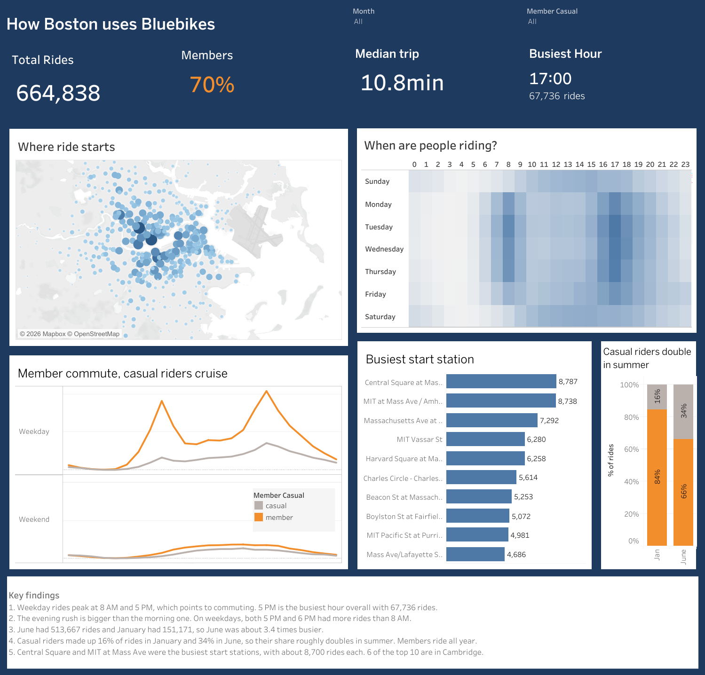

# How Boston uses Bluebikes

Interactive Tableau dashboard of Bluebikes trips in Boston for January and June 2026.

**Live dashboard:** https://public.tableau.com/app/profile/kavya.patel1160/viz/Book1_17930696691050/BluebikesDashboard

## Questions
1. How many rides happened, and what share were members vs casual riders?
2. What days and hours are busiest?
3. Do members and casual riders ride at different times?
4. Which stations are the busiest, and where are they?
5. How different is June from January?

## Data
Bluebikes trip history for January and June 2026, from bluebikes.com/system-data.
The raw files are not in this repo because of their size. Download them from the link above
and place them in `data/raw/`.

## Cleaning (done in Tableau with data source filters)
- Removed rides with no start or end station
- Kept rides between 1 and 180 minutes
- Removed 47 rides that started on May 31 or Dec 31 but were included in the June and January files
- 667,850 rides before cleaning, 664,838 after (3,012 removed, about 0.45%)

## Key findings
1. Weekday rides peak at 8 AM and 5 PM, which points to commuting. 5 PM is the busiest hour overall with 67,736 rides.
2. The evening rush is bigger than the morning one. On weekdays, both 5 PM and 6 PM had more rides than 8 AM.
3. June had 513,667 rides and January had 151,171, so June was about 3.4 times busier.
4. Casual riders made up 16% of rides in January and 34% in June, so their share roughly doubles in summer.
5. Central Square and MIT at Mass Ave were the busiest start stations, with about 8,700 rides each. 6 of the top 10 are in Cambridge.

## Dashboard features
- Month and rider type filters that update every chart
- Click a station on the map to filter the KPIs, heatmap, and line chart to that station
- Calculated fields for trip length, weekday vs weekend, and member share

## Tools
Tableau Public
